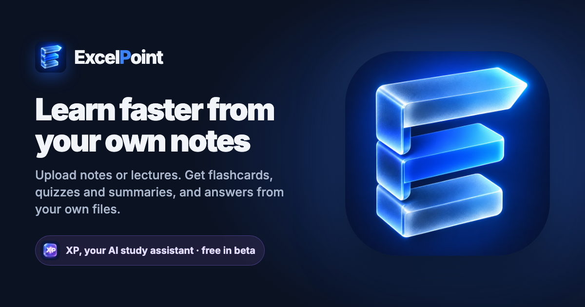

# ExcelPoint



ExcelPoint is a study app. Students upload their own class material (PDF or Word notes, or lecture recordings), and every file becomes a summary, flashcards and a quiz. **XP**, the AI study assistant, answers questions using only those files, shows the exact passage behind each answer, and says "Not in your materials" when a question isn't covered. With **Explain it back**, it turns around: the student explains a topic out loud or in writing, and XP checks every sentence against their notes.

Free while in beta. [Product brief](https://claude.ai/artifact/76HBvLPusaVo8TZEcE9FTm) · [Demo video](https://drive.google.com/file/d/1yBZ8Cexa4Lhrnot7D3OiEqdqtsfgFxn5/view)

## What a student can do

- **Subjects:** one per class (for example Biology), holding that class's files, flashcards, quizzes and chats.
- **Uploads:** PDF, Word (.docx), audio (MP3, WAV, M4A) and video (MP4, MOV, AVI), up to 100 MB; recordings up to 3 hours. Broken or unsupported files are refused with a reason, and a notification arrives when processing finishes or fails.
- **XP chat:** answers only from that subject's files, streams the answer, shows its sources, and marks whether every statement was checked against them. "How was this answered?" explains the answer in plain words.
- **Explain it back:** pick a topic from your file summaries, a whole file, or type your own (XP suggests close topics if your files don't cover it). Explain it by voice (30 seconds to 3 minutes, with a timer) or by typing, check and fix what XP heard, then XP marks every sentence **Correct**, **Not quite** (with the passage that shows the right answer) or **Not in your notes** (never wrong just because the notes are silent), and lists key points you missed. XP replies in a short spoken message: one thing you got right, one correction, one question. After up to 4 rounds you get a summary with coverage and accuracy, saved in the subject so you can see if you improve. Recordings are never kept, only the text.
- **Coverage map:** each subject shows how much of its material you've studied ("You've studied 62% of Biology. Chapter 4 hasn't come up yet."). Files are split into sections (Word headings, PDF chapters or page groups, or 10-minute stretches of a recording), each marked **Not studied**, **Shaky**, **Solid** or **Fading** with a label and icon, and a "Why is this shaky?" reason. Any section opens to its text and three ways to study it: its flashcards, a 5-question quiz on just that section, or explaining it to XP.
- **Flashcards:** spaced repetition (SM-2, the method Anki uses). On a new card, Hard comes back in 1 day, Good in 3 and Easy in 7.
- **Quizzes:** one per file, fresh questions on request, explained results, and "Save & exit" to resume later.
- **Today page:** cards to review, ranked next steps (fading and untouched parts of your files first), recent conversations and a shortcut to Explain it back.
- **Insights:** answer quality over time, and a full trace for each answer and each Explain it back check.
- **Account:** email and password (with an emailed reset link) or Google sign-in, light and dark themes, download all your data as a zip, delete any file, subject, chat, Explain it back session or the whole account.

Works on phones (tested at 375 px on slow 3G). Privacy and Terms pages are at `/app/privacy` and `/app/terms`.

## How XP answers

XP answers **only from the student's uploaded files**:

1. The question is embedded (`all-MiniLM-L6-v2`, on our own server) and matched against that subject's passages in Postgres (pgvector, HNSW index).
2. If nothing scores above the similarity cut-off (0.3), XP replies "Not in your materials" and no AI is called. Broad requests such as "Summarise the key ideas" use the closest passages instead.
3. Otherwise the reasoning pipeline runs: retrieve, generate a strict cited answer, verify each statement, and retry if unfaithful. Follow-ups are first rewritten from the chat history. That is 2 AI calls for a normal question and 3 for a follow-up.
4. Every answer is saved as a trace and scored (faithfulness, unsupported statements, retrieval similarity), and logged as one JSON line (`"event": "chat_answer"`).

After an upload, a Celery worker reads the file (python-docx for Word, pypdf for PDF) or has it transcribed by OpenAI `gpt-transcribe` (ffmpeg first cuts recordings into chunks under the API's 25 MB limit). It then splits and indexes the text and writes flashcards, a quiz and a summary in parallel.

## How Explain it back checks a student

1. The topic (or the file's summary) is matched against the subject's passages with the same search and the same 0.3 cut-off as chat. A topic with nothing above it is refused, and the closest topics from the file summaries are suggested (ranked locally, no AI call).
2. A voice explanation is sent once to OpenAI's cheapest transcription model (`EXPLAIN_TRANSCRIBE_MODEL`, default `gpt-4o-mini-transcribe`) and the audio is thrown away. The student sees and can correct the text before anything is checked.
3. Each check is **one AI call** in JSON mode: it splits the explanation into statements, marks each against the passages (the session's passages plus the closest ones to what was said), tracks which key points are covered, and writes XP's reply (under about 20 seconds, no citations read aloud). The server drops any mark whose passage XP didn't actually have, so every "Correct" or "Not quite" shows real evidence.
4. XP's reply is spoken by the device's own voice (`XP_VOICE=browser`, free) or by OpenAI (`XP_VOICE=openai`, with `XP_VOICE_MODEL` and `XP_VOICE_NAME`).
5. Each check is saved as a trace (`kind='explain'`) that opens in Insights, but it is left out of XP's answer-quality numbers. Each student gets 30 checks per rolling 24 hours (`EXPLAIN_DAILY_LIMIT`), and transcriptions and spoken replies have their own cap (`EXPLAIN_AUDIO_RATE_LIMIT`).

## How the Coverage map works

1. When a file is processed, its passages are grouped into sections (at most 15): Word `Heading 1`/`Heading 2`, a PDF's chapter bookmarks or else page groups, or 10-minute ranges of a recording (estimated from position in the transcript, since the transcription model gives no timestamps). Sections without a heading are named by one small AI call per file. Files processed before the map existed get sections the first time their map is opened.
2. Each flashcard and quiz question is linked to the section of its closest passage (local embeddings, no AI call). Explain it back marks already point at a passage.
3. Statuses are worked out live from reviews, quiz answers and explanations, so nothing extra is stored:
   - **Not studied:** nothing has touched it.
   - **Shaky:** the latest explanation of it had a mistake, a card was last rated Again or Hard, under 70% of its last 5 quiz answers were right, or it was only right once.
   - **Solid:** right on 2 or more separate occasions (a correct explanation counts as 2).
   - **Fading:** would be solid, but untouched for 21 days or one of its cards is more than a day overdue.
4. The % is weighted by section length. Today suggests fading parts first, then the biggest untouched ones, then shaky ones.

| Tool | Where |
| --- | --- |
| Quality dashboard | `/app/insights` |
| Per-answer trace | `/app/insights/<session-id>`, or "How was this answered?" in the chat |
| Retrieval benchmark (hit@k, MRR) | `python manage.py benchmark_retrieval docs/retrieval_benchmark.example.json` |
| Optional LLM judge (one extra call per answer) | `EVAL_LLM_JUDGE=True`, or `python manage.py judge_answers` |

## Tech stack

- **Backend:** Django 5.2 and Django REST Framework on Python 3.13; Celery and Redis for background work and the daily review reminder.
- **Database:** PostgreSQL with pgvector (HNSW index).
- **AI:** OpenAI chat models (default `gpt-5.4-mini`, set with `OPENAI_MODEL`), `gpt-transcribe` for uploaded recordings and `gpt-4o-mini-transcribe` for spoken explanations; XP's spoken replies use the browser's speech by default; sentence-transformers embeddings run locally.
- **Frontend:** a React 19 and TypeScript app in `frontend/` (React Router, TanStack Query, Motion, Vite), served by Django at `/app/`. Answers stream over Server-Sent Events.
- **Brand:** the 3D "E" icon and the "Excel**P**oint" wordmark for the product, the purple 3D "XP" icon for the assistant. Originals are in `branding/`.

## Getting started

### Prerequisites

- Python 3.13+, Node.js 20+
- PostgreSQL 13+ with the [pgvector](https://github.com/pgvector/pgvector) extension (0.8+)
- Redis 6+
- ffmpeg (for audio and video uploads)

### Install

```bash
git clone https://github.com/Nwachukwu1300/excelpoint.git
cd excelpoint
python -m venv venv && source venv/bin/activate
python -m pip install -r requirements.txt
npm --prefix frontend install
npm --prefix frontend run build        # builds the app into static/app/
cp .env.example .env                   # then fill in the database and OpenAI settings
python manage.py migrate
```

pgvector: on Postgres 17/18 with Homebrew, `brew install pgvector`; for other versions, build v0.8.0 against your server's `pg_config` (`make PG_CONFIG=... && make install`).

### Run

```bash
python manage.py runserver                                       # the app at http://localhost:8000/app/
python -m celery -A config.celery.app worker -l INFO --pool=solo # processes uploads, sends emails
python -m celery -A config.celery.app beat -l INFO               # daily flashcard reminders
redis-server
```

Without `EMAIL_HOST` in `.env`, password-reset emails are printed to the worker's console.

### Test

```bash
TESTING=1 python manage.py test          # backend; needs Postgres with pgvector and ffmpeg; never calls OpenAI
npm --prefix frontend test               # the app (Vitest); also: cd frontend && npx tsc --noEmit
```

CI runs both on every push to `main`, and builds the Docker image for amd64 and arm64.

## Deploying

One server with Docker runs everything: gunicorn, a Celery worker and beat, Postgres with pgvector, Redis, Caddy for HTTPS, and a nightly database backup.

**Free setup, step by step:** [docs/deploy-oracle.md](docs/deploy-oracle.md) (Oracle Cloud Always Free, a DuckDNS address and Gmail for password emails), with a one-command installer, `deploy/setup-server.sh`.

Any other server:

1. Point your domain's DNS at the server and open ports 80 and 443.
2. `cp .env.example .env`, then set `DOMAIN`, `ALLOWED_HOSTS` (your domain), `DEBUG=False`, a fresh `DJANGO_SECRET_KEY`, `DB_USER` and `DB_PASSWORD`, `OPENAI_API_KEY`, the `EMAIL_*` settings, and Google OAuth if you use it (`GOOGLE_OAUTH_REDIRECT_URI=https://<domain>/users/google/callback/`).
3. `docker compose up -d --build`. Migrations run first; Caddy fetches the certificate.
4. Once the site works over HTTPS, set `SECURE_HSTS_SECONDS=31536000` and run `docker compose up -d` again.

Uploads live in the `media` volume and the database in `pgdata`. The `backup` service keeps the last 7 nightly database dumps in the `backups` volume; copy them and `media` off the server too.

## Known limitations

- Scanned PDFs (pictures of text) can't be read yet.
- There is no daily upload limit per student yet; each upload costs a few AI calls.
- Explain it back needs a browser that can record audio (current Chrome, Safari, Edge or Firefox) and HTTPS for the microphone. The browser voice sounds different on each device; set `XP_VOICE=openai` for one consistent voice.
- Without `CACHE_URL` (local runs), rate limits are counted per server process; docker compose sets a shared Redis cache.

## Contact

<mnfinance664@gmail.com>

---

Built by Mmesoma
